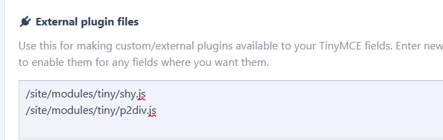
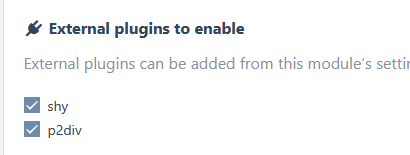
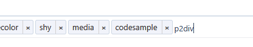
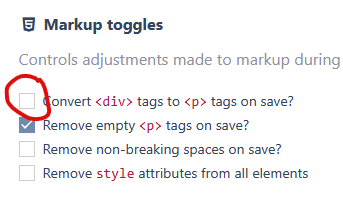

# pw-tinymce-p2div-plugin

## Convert a “p” to a “div” in TinyMCE

to install it in pw, put the js file whereever you want, e.g. /site/modules/tinymce (up to you) (the assets folder is only here to make the readme more... readable you only need the js file)

then go to modules -> configure -> InputfieldTinyMCE

and add the file path in the External plugin files textarea (for exemple /site/modules/tinymce/p2div.js) and save

now, in the field you want to use it, input tab, enable the plugin

and add it to the toolbar simply writing its name (p2div) in the input and hit enter

now you should see a new button in your tinyMCE toolbar,

to use it, just put your carret (click) anywhere inside the p you cant to target, hit the button, done

don't forget to uncheck the "convert div tags to p tags" in the field input markup toggles

---
Of course, as usual, you can modify whatever you want in the plugin code change its name, je js file name, change or remove the text in the toolbar (leave empty single quotes), change or remove the tooltip (here you can simply delete the line) and so on

long story short, do whatever you want and need with it :)

